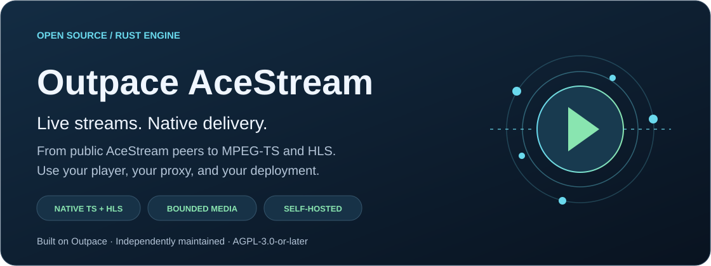
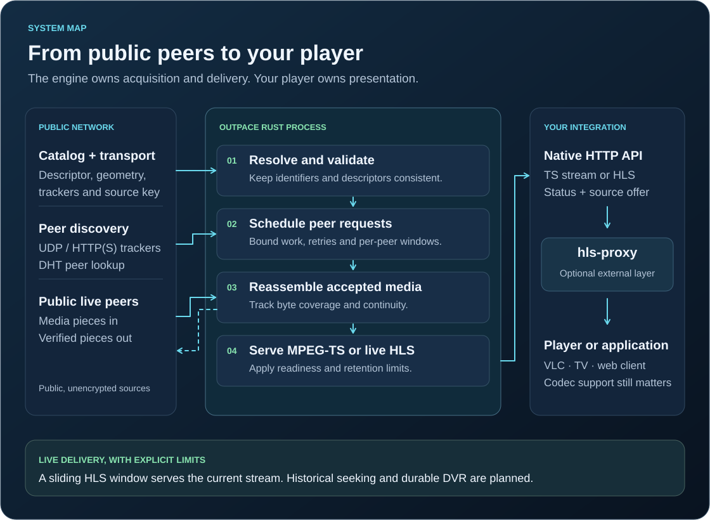

# Outpace AceStream

[](https://github.com/open-ott-play/outpace-acestream/actions/workflows/release.yml)



**A native Rust engine that turns public, unencrypted AceStream sources into
MPEG-TS and HLS for your player.** Run it on Windows, Linux or macOS, in Docker,
or in a Kubernetes or k3s cluster. It works directly with HTTP-capable players
and through middleware such as hls-proxy.

Outpace AceStream independently develops [Outpace](https://github.com/jamezrin/outpace),
preserving its history, attribution and **AGPL-3.0-or-later** license. It does not
require an original closed-source engine at runtime and is not an official Ace
Stream product. The executable remains `outpace`; configuration uses `OUTPACE_*`.

[v0.9.0 release](https://github.com/open-ott-play/outpace-acestream/releases/tag/v0.9.0)
· [0.9.0 changes](docs/releases/v0.9.0.md)
· [0.9.1-beta.14 changes](docs/releases/v0.9.1-beta.14.md)
· [Previous stable v0.8.1](https://github.com/open-ott-play/outpace-acestream/releases/tag/v0.8.1)
· [Beta.8 history](docs/releases/v0.9.0-beta.8.md)
· [Retained replay](docs/timeshift.md)
· [Documentation](docs/README.md)
· [HTTP API](docs/native-api.md)
· [Troubleshooting](docs/troubleshooting.md)
· [Roadmap](docs/roadmap.md)

Reading this file from a downloaded binary package? Open the
[online handbook](https://github.com/open-ott-play/outpace-acestream/blob/main/docs/README.md)
for working navigation and diagrams. The matching source archives contain the
documentation for the build they accompany.

Every `Release` workflow run with `channel=rc` automatically runs the normal
checks and fuzzes the configured production parser boundaries. The RC gate requires all
stages and matching fuzz evidence to pass. See the [RC workflow](docs/ci-cd.md#rc-source-pipeline)
and [targets, evidence and limits](docs/fuzzing.md); source RC checks do not replace
product archive or runtime acceptance.

## Start here

| Your environment or task | Guide |
| --- | --- |
| Windows x64 or ARM64 | [Binary download, verification and PowerShell setup](docs/installation.md#windows-install-and-run-with-powershell) |
| Linux x64, ARM64 or ARMv7 | [Binary installation and systemd](docs/installation.md#linux-run-and-install-a-systemd-service) |
| macOS Apple Silicon or Intel | [Native installation and LaunchAgent](docs/installation.md#macos-run-and-install-a-launchagent) |
| Docker or Docker Compose | [Containers, storage, ports and upgrades](docs/containers.md) |
| Kubernetes or k3s | [Cluster deployment and example manifests](docs/kubernetes.md) |
| VLC, hls-proxy or another player | [Playback routes and integration](docs/playback.md) |
| Tuning and operations | [Configuration](docs/configuration.md) · [Troubleshooting](docs/troubleshooting.md) · [Audio inventory](tools/audioscan/README.md) |
| Development and source distribution | [Architecture](docs/architecture.md) · [Development](docs/development.md) · [Licensing](docs/licensing.md) |

The installation examples target **v0.9.0**; verify its published assets before
installing, and pin a verified image digest for production containers.
Historical version differences remain explicit. In particular, set
**both `OUTPACE_DATA_DIR` and `OUTPACE_CACHE_DIR`** when moving
v0.8.1 state to a service directory or volume. Its default-cache derivation was
fixed after that release. Windows currently supports in-memory peer hints, not
the Unix durable peer-hint backend; follow the Windows-specific recipe.

## What it does

| Capability | Current behavior |
| --- | --- |
| Live acquisition | Resolves descriptors, discovers peers, verifies and reassembles supported public AceStream media. |
| Playback output | Direct MPEG-TS and bounded live HLS, with shared source sessions for multiple consumers. |
| Ace HTTP compatibility | An explicit subset, enabled with `OUTPACE_ACE_COMPAT=1`; see the [compatibility contract](docs/deployment-compatibility.md). |
| Single-file VOD | Verified file pieces, HTTP byte ranges and native VOD HLS. Requires a VOD descriptor. |
| Origin HLS | Optional bounded local HTTP relay for resolved HLS descriptors, including TS/fMP4 and ranges. Default direct handoff is preserved. See [source resolution](docs/source-resolution.md). |
| Broadcast origination | Signed broadcasts from raw HTTP MPEG-TS, RTMP or managed HTTP(S) MPEG-TS input. |
| Audio conversion | Optional FFmpeg-based conversion of selected supported live-HLS audio to AAC stereo. Video is copied. |
| Historical playback | Opt-in finite retained-HLS replay with independent viewer generations; experimental exact peer-history acquisition. No UTC programme archive or durable DVR. See [timeshift](docs/timeshift.md). |

Channel discovery, playlist curation, EPG and the television interface belong to
the player or proxy. Codec support still depends on that player. Premium or
encrypted sources and full closed-engine API parity are outside the supported
scope.

## First run

[Install and verify the package for your platform](docs/installation.md), then
start the daemon using that guide's environment settings. With the binary on
`PATH`, the command is:

```sh
outpace serve
```

In another terminal, check the HTTP listener and the exact build:

```sh
curl --fail --show-error http://127.0.0.1:6878/healthz
curl --fail --show-error http://127.0.0.1:6878/source.json
```

In PowerShell, use `Invoke-RestMethod` for these URLs. A successful health check
means the process answers HTTP; it does not prove that a source has peers or
that your player can decode its media.

Open a native HLS URL in the player, replacing the synthetic ID with a current
content ID you are authorized to use:

```text
http://127.0.0.1:6878/streams/ace/cid:0123456789abcdef0123456789abcdef01234567.m3u8
```

The example ID is deliberately nonfunctional. Content IDs and infohashes are
different selectors: use `cid:` for a content ID and `ih:` for an infohash. A
cold infohash still needs a verified descriptor before media can start. See
[playback](docs/playback.md) for CLI, direct TS, compatibility and VOD routes.

For a remote player, `127.0.0.1` refers to that player's own machine. Configure
access through a trusted proxy or a deliberately exposed service, and use an
address reachable by whoever fetches both the playlist and its segments. The
engine API has control and ingest operations as well as playback: it is not a
public authenticated streaming gateway.

## How it fits together



The live follower acquires and authenticates media, the session manager shares
that work, and the HTTP layer exposes playback. Limits cover individual queues,
piece stores and HLS windows; they are not a promise of fixed total process
memory for an unlimited number of sources. Start with defaults and measure the
actual bottleneck before increasing buffers.

Native defaults are HTTP **`127.0.0.1:6878`**, RTMP ingest
**`127.0.0.1:1935`**, and inbound peer TCP **`0.0.0.0:8621`**. Seeding and inbound
peer participation are enabled; automatic router port mapping is disabled.
DHT and UDP trackers need outbound UDP with return traffic, not a published UDP
8621 listener. Container and cluster guides explain their different network
boundaries.

Read the [architecture guide](docs/architecture.md) for code ownership, source
resolution, session lifetime, persistent identity and disposable media storage.

## Build, test and contribute

From a Git checkout, use the toolchain pinned in `rust-toolchain.toml`:

```sh
cargo build --locked --release -p ace-engine --bin outpace
cargo fmt --all --check
cargo clippy --workspace --all-targets --locked -- -D warnings
cargo test --workspace --locked
```

Tests are offline by default; real swarm tests require an explicit, bounded
operator run. See [development](docs/development.md),
[repository maintenance](docs/repository-maintenance.md), and
[AGENTS.md](AGENTS.md) before contributing. Keep real content IDs, infohashes,
channel names, private captures and credentials out of commits and issue reports.

Binary packages cover seven platform targets; the public container covers
Linux amd64, arm64 and arm/v7. Build availability is not a claim that every OS
version, device, source or decoder was tested. The installation guide states
platform prerequisites and limitations.

## License, acknowledgements and matching source

Thanks to the original [Outpace project](https://github.com/jamezrin/outpace) and
its contributors. See [AUTHORS.md](AUTHORS.md), [NOTICE](NOTICE) and
[LICENSE](LICENSE) for attribution and the retained AGPL-3.0-or-later terms.

Every build embeds its workspace source. The running service exposes `/source`,
`/source.json` and `/source.tar.gz`; `outpace source` also exports it offline.
Published releases pair each binary with a complete source archive containing
locked dependency sources, notices and rebuild instructions. Containers preserve
that binary/source pairing. A modified build needs its own matching source
offer; linking to an unrelated release is insufficient.

Keep source access reachable through integrations and reverse proxies. Read
[licensing and source distribution](docs/licensing.md) for the packaging workflow,
modified builds and the limits of reproducibility claims.
