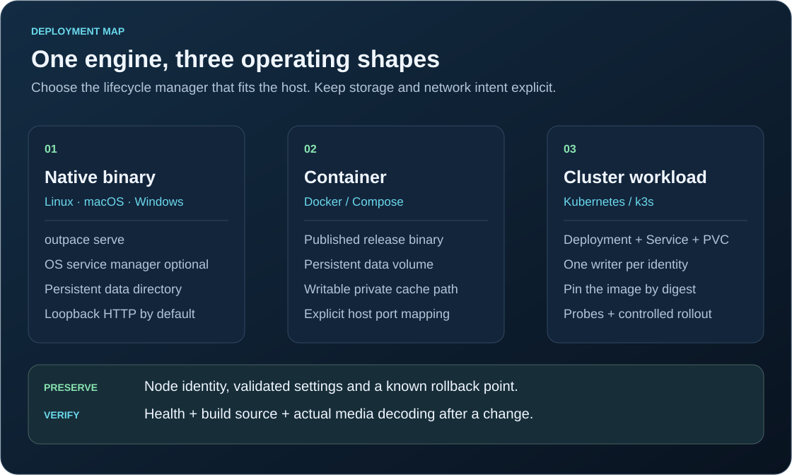
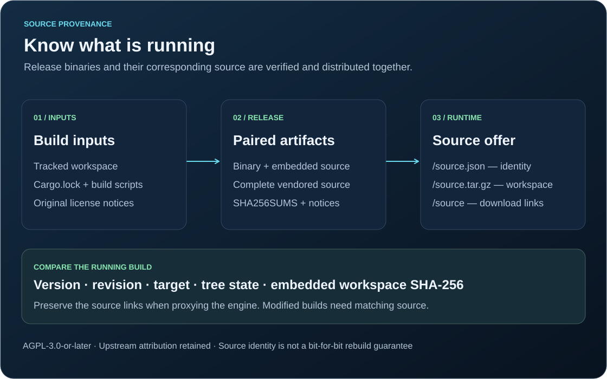

# Architecture

Outpace AceStream is a Rust engine for acquiring public, unencrypted AceStream
media and exposing it through a local or managed HTTP service. The executable is
`outpace`. It supplies media to a player; it does not contain a television UI,
channel catalog, EPG, or a player decoder. A service such as `hls-proxy` can sit
between the engine and a player, but direct playback also works.

This project independently develops [Outpace](https://github.com/jamezrin/outpace)
and retains its AGPL-3.0-or-later license and attribution. See
[licensing and source distribution](licensing.md), [NOTICE](../NOTICE), and
[AUTHORS.md](../AUTHORS.md).

## Live media path

1. **Resolve the source.** A content ID resolves to a transport descriptor. The
   descriptor supplies the stream identity, piece and chunk geometry, source
   verification key, and trackers. An infohash alone does not supply enough
   information to safely reconstruct a live stream. Descriptor validation and
   consistency checks remain necessary even when discovery finds peers.
2. **Find candidate peers.** HTTP(S) trackers, UDP trackers, and DHT discovery run
   concurrently. Recent productive peer addresses are additional local hints;
   they never replace the descriptor or its validation. Discovering an address
   does not mean that peer can supply useful current media.
3. **Acquire and reassemble.** The production
   [`follow_live`](../crates/ace-swarm/src/live_session/mod.rs) follower bounds
   outstanding work, connection attempts, and per-peer request windows. It
   tracks byte coverage and verifies media according to the descriptor before
   emitting contiguous output. Its `LiveOutput` includes discontinuity and
   startup-completion signals as well as media bytes. Complete verified pieces
   may enter the seeding store; packaged HLS segments are not the peer protocol.
4. **Deliver media.** The engine's shared session manager feeds direct MPEG-TS
   responses and the native HLS packager. HLS readiness depends on usable media,
   not just an open HTTP connection. Segment count, byte limits, and expiry bound
   the retained live window.
5. **Decode and present.** A player receives the stream directly or through an
   optional proxy. Device codec support, network delivery, and player buffering
   still affect whether and when a picture appears. An HTTP `200`, a healthy
   process, or a growing byte counter alone does not establish successful
   playback.

See the [playback guide](playback.md) for integration examples and the
[native API reference](native-api.md) for exact route and identifier semantics.

## Sessions, outputs, and ownership

Live TS and HLS requests for the same canonical source share acquisition.
Playback starts or joins that session. Status reads and individual segment
requests only observe existing work; they do not start a new source. Stopping a
session, losing a source, or replacing an HLS packager changes its lifetime.
Compatibility playback tokens bind to the source and packager generation, so
stale requests cannot silently control a replacement session.

The manager explicitly cancels its live sources when it stops a session, shuts down,
or is dropped, even if a caller retains a session handle. Already queued data may
drain before a receiver observes the closed source. Idle removal retains the existing
ownership handoff: a caller that has just acquired a session can still attach its
receiver before releasing that handle.

The HLS playlist describes a moving window. A segment can disappear after its
retention and grace periods, even if a player still remembers the URL. This is a
bounded live service, not an unlimited media history. Independent compatibility
client leases and their idle expiry are described in
[deployment compatibility](deployment-compatibility.md#compatibility-hls-ownership).

Other media paths have separate contracts:

- **HLS-origin descriptors:** a transport with `type=hls` is handed off to its
  original HTTP(S) manifest by the compatibility routes. This does not relay HLS
  over the peer network or reconstruct its media as a classic live swarm.
- **Single-file VOD:** the VOD routes verify file pieces and expose byte ranges
  and VOD HLS. A seekable file is different from seeking back into a live
  programme.
- **Broadcast origination:** raw HTTP MPEG-TS, RTMP, and managed HTTP MPEG-TS
  sources can feed an engine-owned broadcast. This path maintains its own
  signing identity, piece index reservations, producer ownership, and
  announcements. It is not required to consume an existing public stream.
- **Optional audio normalization:** supported HLS audio can use an external
  FFmpeg process when explicitly enabled. Ordinary native TS/HLS delivery does
  not require this feature. It is not a general video transcoder or a guarantee
  that every client can decode every source.

## Code map

| Area | Responsibility |
| --- | --- |
| [`ace-wire`](../crates/ace-wire) | Wire messages, transport structures, identity, verification, and piece reassembly. |
| [`ace-peer`](../crates/ace-peer) | Peer sessions and protocol exchange. |
| [`ace-tracker`](../crates/ace-tracker) | Tracker protocol access. |
| [`ace-swarm`](../crates/ace-swarm) | Resolution, discovery, scheduling, live following, VOD, and seeding. |
| [`ace-media`](../crates/ace-media) | MPEG-TS and other media helpers. |
| [`ace-engine`](../crates/ace-engine) | CLI, runtime configuration, shared sessions, HTTP API, HLS, RTMP, and broadcasts. |
| [`ace-log`](../crates/ace-log) | Dependency-free operational logging. |

Useful entry points are [`runtime.rs`](../crates/ace-engine/src/runtime.rs),
[`manager.rs`](../crates/ace-engine/src/manager.rs),
[`hls.rs`](../crates/ace-engine/src/hls.rs), and the
[`live_session` module](../crates/ace-swarm/src/live_session/mod.rs). Protocol
research lives under [`docs/protocol`](protocol/); implementation history and
accepted changes are summarized in [upstream integration](upstream-integration.md).

## State and storage

Keep these storage classes distinct when deploying or diagnosing the engine:

- **Persistent identity:** the data directory holds `identity.seed` and saved
  broadcast identities/reservations. Preserve it across ordinary upgrades.
  Independent running instances must not share one writable identity directory.
- **Recent peer hints:** the bounded `recent-peers-v1` cache records productive
  candidates with expiry. It can reduce rediscovery work, but an old address is
  not proof of availability or source identity. On Unix, memory-cache mode can
  preserve hints under a nonempty cache directory across restarts. Disk-cache
  startup clears that directory before hints are loaded, so hints stored there
  do not survive a daemon restart. The current file backend requires Unix
  filesystem checks; Windows continues with in-memory hints. This limitation is
  separate from binary/build support.
- **Media buffers and seed cache:** memory is the default seed-store backend.
  Disk backing trades memory for bounded disk capacity. The disk media cache is
  disposable and cleared at startup under dedicated-directory checks. It must
  not contain unrelated files and is not a durable recording archive.
- **HLS retention:** advertised segments and their bounded grace storage serve
  active live playback. Increasing that budget does not create independent
  historical playback sessions.

Configure data and cache paths explicitly for a service account or container.
For the published v0.8.1 binary, set `OUTPACE_CACHE_DIR` as well as
`OUTPACE_DATA_DIR` when changing the data location: that release does not derive
the default cache path from the overridden data directory. The source tree
contains the subsequent correction. See [configuration](configuration.md) and
[installation](installation.md) for deployment commands and platform details.

## Deployment boundaries

Packaging changes how the process is launched and supervised, not the media
protocol or source-offer contract. The native defaults bind the HTTP API to
`127.0.0.1:6878`, RTMP ingest to `127.0.0.1:1935`, and the peer TCP listener to
`0.0.0.0:8621`. Inbound peer serving and seeding are enabled by default; automatic
port mapping and compatibility routes are opt-in. There is no fixed UDP peer
listener on port 8621: DHT and UDP tracker exchanges use outbound sockets and
their replies.

Containers need a reachable internal bind and an explicit host-port policy.
Kubernetes needs writable storage, a controlled rollout, and a Service whose
exposure matches the intended clients. Neither container port publishing nor a
Kubernetes Service supplies API authentication. Protect any remotely reachable
control API and ingest routes through the chosen network or authenticating
proxy boundary. Keep the engine's source offer accessible through that boundary.

Readiness checks should distinguish process health, source identity, and actual
decoded playback. `/healthz` confirms process health; it does not contact a
catalog, find a peer, or decode a frame. The [container guide](containers.md) and
[Kubernetes/k3s guide](kubernetes.md) cover lifecycle and rollback; the
[advanced deployment reference](deployment.md) adds Compose details. Windows
build availability does not imply the same live playback qualification already
performed on macOS and k3s.

## Build and source provenance

The binary embeds a workspace source archive and metadata at build time.
`/source.json` identifies the version, base revision, build target, tree state,
and embedded workspace checksum. `/source.tar.gz` serves that embedded archive;
`outpace source` supports offline extraction. The `/source` page links both the
workspace and, for a release build, its complete corresponding-source bundle.
That complete bundle includes locked Rust dependency sources, their notices,
and offline rebuild instructions. The API also advertises source and license
links in response headers.

Compare the actual running build with its associated artifacts when upgrading
or investigating a deployment. A version string or base revision alone cannot
identify tracked local modifications. A published release bundle is not the
matching source for a differently modified binary. Preserve the original
license and attribution alongside new work, and publish corresponding source
for the build being distributed or served. Checksums identify the packaged
source; they do not promise bit-for-bit reproducible output across toolchains
and build hosts.

## Current limits and development direction

Historical live seeking, independent rewind cursors, and durable DVR are not
implemented by the current engine. The [roadmap](roadmap.md) separates a proof
of historical acquisition from the peer network, independent playback-session
ownership, and optional persistent recording. Each requires its own media
availability, time indexing, bounded storage, cancellation, and recovery work.

Optimization should measure resolution, discovery, first accepted media, HLS
readiness, and the first decoded frame separately. Preserve verification,
bounded queues, and generation ownership while reducing avoidable work. A
larger buffer or a faster synthetic test is not evidence that every public
source starts sooner or plays continuously.
